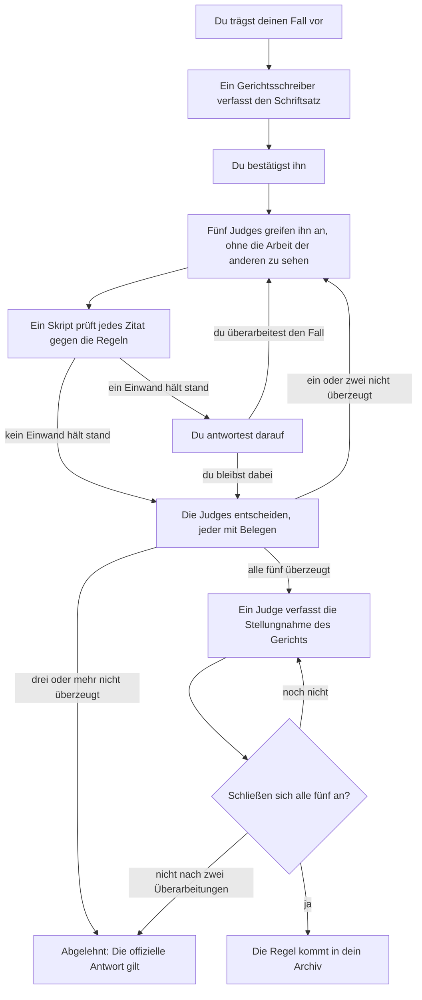

<h1 align="center">
  <picture>
    <source media="(prefers-color-scheme: dark)" srcset="assets/bb-lockup-dark-bg.svg">
    
  </picture>
</h1>

<p align="center">
  Antworten auf Regelfragen zu Magic: The Gathering aus den offiziellen Dokumenten, mit Belegstellen, für Claude.
</p>

<p align="center">
  <a href="https://github.com/smithy-org/bishop-and-barrister/releases/latest"></a>
  <a href="https://github.com/smithy-org/bishop-and-barrister/actions/workflows/tests.yml"></a>
  <a href="LICENSE"></a>
  <a href="https://ko-fi.com/pjderouen"></a>
</p>

<p align="center">
  <a href="README.md">English</a> · Deutsch · <a href="README-es.md">Español</a> · <a href="README-fr.md">Français</a> · <a href="README-it.md">Italiano</a> · <a href="README-ja.md">日本語</a>
</p>

<p align="center">
  <em>Dies ist eine Übersetzung des <a href="README.md">English README</a>. Weichen die beiden voneinander ab, gilt die englische Fassung.</em>
</p>

Ein Claude-Skill, der Regelfragen zu Magic: The Gathering anhand der offiziellen Comprehensive Rules und des
aktuellen Oracle-Kartentexts beantwortet statt aus dem Gedächtnis, und die Regeln zitiert, auf die er sich stützt.

> **Du:** Ich habe `[[Blood Moon]] (Blutmond)` im Spiel. Macht `[[Urborg, Tomb of Yawgmoth]] (Urborg, Grab von Yawgmoth)`
> meines Gegners dessen Länder trotzdem noch zu Sümpfen?
>
> **Claude:** Nein. `[[Blood Moon]] (Blutmond)` macht es zu einem Gebirge, und ein Land, dessen Standardlandart
> festgelegt wird, verliert seine anderen Fähigkeiten (305.7). Beide Effekte wirken in Schicht 4 (613.1d); da der
> eine den anderen entfernt, wird `[[Blood Moon]] (Blutmond)` zuerst angewendet (613.8a), also wird kein Land zum
> Sumpf.

## Inhalt

- [Funktionen](#funktionen)
- [Voraussetzungen](#voraussetzungen)
- [So funktioniert es](#so-funktioniert-es)
- [Installation](#installation)
- [Verwendung](#verwendung)
- [Zukunftspläne](#zukunftspläne)
- [Unterstützung](#unterstützung)
- [Lizenz](#lizenz)
- [Fan Content](#fan-content)

## Funktionen

- **Antworten mit Belegstellen.** Jede Antwort nennt ihre Regeln (`704.5g`, nicht „die Regel zu den
  zustandsbasierten Aktionen“).
- **Immer aktuell.** Oracle-Text, Rulings und Legalität kommen live von [Scryfall](https://scryfall.com); die
  Regeldokumente werden auf Wunsch aktualisiert.
- **Turnierfest.** MTR, IPG und JAR, zitiert nach Abschnitt und Datum, wobei Regular und Competitive REL sauber
  getrennt bleiben.
- **Elf Formate.** Commander, Brawl, Oathbreaker, Standard, Pioneer, Modern, Legacy, Vintage, Pauper, Draft
  und Sealed.
- **Ehrlich, wenn es offen ist.** Wenn nichts Offizielles eine Frage entscheidet, sagt es das und verweist dich an
  einen Judge.
- **Anfechtungen.** Fechte eine Antwort vor fünf kritischen Judges an; nur ein einstimmig angenommener Fall kommt in
  dein Archiv. Siehe [CHALLENGE.md](plugin/skills/bishop-and-barrister/CHALLENGE.md).
- **Lokal.** Dein Ruling-Archiv und deine Dokumente bleiben auf deinem Rechner.

## Voraussetzungen

- Claude Code oder claude.ai mit aktivierter Codeausführung.
- Python 3.10 oder neuer sowie git.
- [`pypdf`](https://pypi.org/project/pypdf/) für die Turnierdokumente (`pip install pypdf`).

## So funktioniert es

Die Quellen sind nach Verbindlichkeit geordnet, und der Skill liest sie in dieser Reihenfolge:

| Stufe | Quelle |
| ----- | ------ |
| 1 | Die Comprehensive Rules, der Oracle-Text und die offiziellen Rulings von Wizards |
| 2 | Die Turnierdokumente (MTR, IPG, JAR) und Regeln, die für ein einzelnes Format verbindlich sind |
| 3 | Inoffizielle Beiträge von Wizards-Mitarbeitern: auf X, Bluesky oder Discord sowie Artikel, die keine Regeldokumente sind |
| 4 | Konsens unter Judges und in der Community sowie Scryfalls eigene Anmerkungen |
| 5 | Regeln, die du per Anfechtung eingeführt hast und die Stufe 1 niemals übersteuern |

Foren und KI-generierte Zusammenfassungen sind niemals Quellen ([`trusted-sources.json`](plugin/skills/bishop-and-barrister/reference/trusted-sources.json)).
Nichts, was Claude antwortet, wird gespeichert: Dein Ruling-Archiv in `~/.claude/bishop-and-barrister/` beginnt mit
den offiziellen Rulings, wächst nur durch Anfechtungen und markiert jede Regel, deren Quellen sich ändern.

**Bishop.** Regelfragen mit bekannten Antworten, einmal mit und einmal ohne den Skill gestellt und an den
offiziellen Regeln gemessen (Anteil bestandener Prüfungen, jeweils der letzte Durchlauf jeder Gruppe; Details in
[`evals/BASELINE.md`](evals/BASELINE.md)):

|                                     | Claude allein | Mit Bishop & Barrister |
| ----------------------------------- | ------------- | ---------------------- |
| Alle Fragen (30)                    | 68%           | **100%**                |
| Karten, die neuer sind als Claudes Training | 39%   | **100%**               |
| Turnierstrafen und Korrekturen      | 52%           | **100%**               |
| Antworten, die echte, passende Regeln zitieren | 57% | **100%**             |

**Barrister.** Eine Regel kommt nur durch eine Anfechtung in dein Archiv, und dieser Ablauf ist in
[Lean 4](https://lean-lang.org) geschrieben, einer funktionalen Sprache, deren Compiler mathematische Beweise
prüft. 23 Theoreme werden bei jedem Build geprüft; schlägt eines fehl, wird nichts veröffentlicht.



Ein **Gerichtsschreiber** bringt dein Argument in nummerierte Tatsachen und Schritte, die jeweils eine Quelle
zitieren, und ein **Prüf**-Skript gleicht jedes Zitat mit den Regeln ab, auf die es sich beruft. Jeder der fünf
Judges hat einen anderen Blickwinkel, damit nicht alle denselben Fehler machen; sie arbeiten parallel und können
die Arbeit der anderen erst sehen, wenn alle fünf abgegeben haben:

1. **Das Regelwerk.** Liest jede zitierte Regel vollständig, auf der Suche nach Bedingungen, die der Fall
   übergeht, nach Ausnahmen und nach späteren Regeln. In einem Eval-Fall stellte sich heraus, dass „der Spieler,
   der zuerst verliert, wählt“ in Teamspielen nicht funktioniert, wo jemand, der früh verliert, trotzdem noch
   gewinnen kann (104.2c).
2. **Karten und Rulings.** Liest den Kartentext Wort für Wort, da Kartentext die Regeln übersteuert, und sucht nach
   offiziellen Rulings zu ähnlichen Karten, die in die andere Richtung weisen.
3. **Simulation des Spielzustands.** Spielt die Situation Schritt für Schritt durch: Stapel, Priorität, ausgelöste
   Fähigkeiten, zustandsbasierte Aktionen, Schichten.
4. **Gegenbeispiele und Logik.** Findet andere Situationen, in denen die Regel falsch liegt, und Lücken in der
   Argumentation.
5. **Turnierdokumente und Formate.** Prüft, ob ein Format oder eine Veranstaltungsstufe die Antwort ändert oder ob
   eine Turnierregel die Frage bereits entscheidet.

Die Theoreme garantieren:

- **Keine unverdiente Regel:** Alle fünf Judges sind mit Belegen überzeugt, jedes Zitat ist geprüft, es gibt
  keinen Widerspruch zu den offiziellen Regeln, und es gibt eine Stellungnahme, der sich alle fünf anschließen.
- **Kein Abschreiben:** Ein Judge kann die Arbeit der anderen aus der laufenden Runde nicht sehen.
- **Deterministisch:** Dasselbe Archiv liefert auf jedem Gerät dasselbe Ergebnis.
- **Endgültig:** Eine einmal eingeführte Regel kann durch den Ablauf nicht rückgängig gemacht werden.
- **Nichts bleibt hängen oder geht verloren:** Jede offene Anfechtung nennt, wer als Nächstes am Zug ist, und
  widersprüchliche Änderungen werden erkannt.

Die Beweise decken den Ablauf ab, nicht die Regeln von Magic; alltägliche Antworten stützen sich auf die zitierten
Dokumente.

## Installation

### Claude Code

```
/plugin install bishop-and-barrister --marketplace https://github.com/smithy-org/bishop-and-barrister.git
```

Starte danach eine neue Sitzung. Bei Claude Code vor Version 2.1.275 führst du zuerst
`/plugin marketplace add https://github.com/smithy-org/bishop-and-barrister.git` aus und dann
`/plugin install bishop-and-barrister@smithy-org`. Verwende die vollständige HTTPS-Adresse: Die Kurzform
`owner/repo` klont über SSH und schlägt ohne GitHub-SSH-Schlüssel fehl.

### claude.ai

1. Lade `bishop-and-barrister.zip` aus dem
   [neuesten Release](https://github.com/smithy-org/bishop-and-barrister/releases/latest) herunter. (GitHubs
   „Download ZIP“ funktioniert nicht: claude.ai braucht einen Ordner namens `bishop-and-barrister`.)
2. Aktiviere unter Settings, Capabilities die Option „Code execution and file creation“.
3. Lade die ZIP-Datei auf derselben Seite unter Skills hoch.

Auf claude.ai noch nicht getestet; der Skill muss scryfall.com, media.wizards.com und github.com erreichen können.

### Die Regeldokumente

Claude lädt die Comprehensive Rules und die Turnierdokumente herunter, sobald es sie zum ersten Mal braucht, und
zwar nach `~/.claude/bishop-and-barrister/documents/`.

## Verwendung

Frag so, wie du einen Judge fragen würdest; der Skill lädt sich von selbst:

- „Kann ich mit Todesberührung und Trampelschaden der blockenden Kreatur nur 1 Schaden zuteilen?“
- „Wenn `[[Humility]] (Demut)` und `[[Opalescence]] (Macht der Opale)` beide im Spiel sind, welche Stärke und
  Widerstandskraft haben die Kreaturen?“
- „Was ist bei Competitive REL die Strafe, wenn man eine Karte zu viel zieht?“

Wenn eine Antwort keine Belegstellen hat, ruf den Skill beim Namen auf: `/bishop-and-barrister:bishop-and-barrister <question>`.

- **Neue Regelversion erschienen?** Bitte Claude, „die Regeldokumente von Bishop & Barrister auf Updates zu
  prüfen“.
- **Nicht einverstanden mit einer Antwort?** Sag „Ich möchte dieses Ruling anfechten“. Claude nennt zuerst die
  Kosten: Eine Anfechtung verbraucht bis zu einige Millionen Tokens. Details in
  [CHALLENGE.md](plugin/skills/bishop-and-barrister/CHALLENGE.md).

## Zukunftspläne

Je nach Interesse: ein **Cloud-Upload**, um dein Ruling-Archiv über mehrere Geräte hinweg synchron zu halten, und
eine **soziale Regelplattform**, um Rulings mit anderen Spielern zu teilen und zu klären. Interesse? Sag es in einem
[Issue](https://github.com/smithy-org/bishop-and-barrister/issues).

## Unterstützung

Kostenlos, für immer. Wenn es an deinem Tisch einen Streit schlichtet, kannst du auf
[Ko-fi](https://ko-fi.com/pjderouen) ein freiwilliges Trinkgeld in beliebiger Höhe dalassen; es schaltet nichts
frei. Melde Bugs und falsche Antworten als
[Issues](https://github.com/smithy-org/bishop-and-barrister/issues).

## Lizenz

[Apache License 2.0](LICENSE). Weitergaben müssen die [NOTICE](NOTICE) beibehalten, die die unten stehende
Fan-Content-Erklärung enthält. Die Lizenz gilt für den eigenen Code und Text dieses Projekts, nicht für die
Materialien von Wizards of the Coast oder die Daten von Scryfall.

## Fan Content

Bishop & Barrister is unofficial Fan Content permitted under the Fan Content Policy. Not approved/endorsed by
Wizards. Portions of the materials used are property of Wizards of the Coast. ©Wizards of the Coast LLC.

*Inoffizielle Übersetzung:* Bishop & Barrister ist inoffizieller Fan Content, der im Rahmen der Fan Content Policy
erlaubt ist. Nicht von Wizards genehmigt oder unterstützt. Teile der verwendeten Materialien sind Eigentum von
Wizards of the Coast. ©Wizards of the Coast LLC.

Kartendaten und Rulings stammen von [Scryfall](https://scryfall.com), das nicht mit diesem Projekt verbunden ist.
