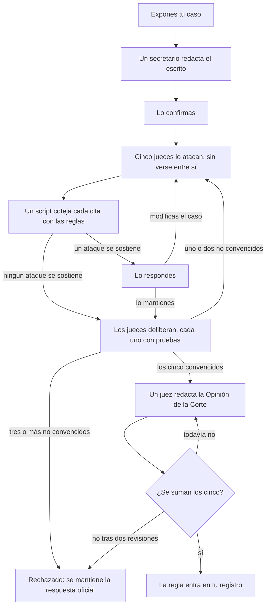

<h1 align="center">
  <picture>
    <source media="(prefers-color-scheme: dark)" srcset="assets/bb-lockup-dark-bg.svg">
    
  </picture>
</h1>

<p align="center">
  Respuestas sobre las reglas de Magic: The Gathering sacadas de los documentos oficiales, con citas, para Claude.
</p>

<p align="center">
  <a href="https://github.com/smithy-org/bishop-and-barrister/releases/latest"></a>
  <a href="https://github.com/smithy-org/bishop-and-barrister/actions/workflows/tests.yml"></a>
  <a href="LICENSE"></a>
  <a href="https://ko-fi.com/pjderouen"></a>
</p>

<p align="center">
  <a href="README.md">English</a> · <a href="README-de.md">Deutsch</a> · Español · <a href="README-fr.md">Français</a> · <a href="README-it.md">Italiano</a> · <a href="README-ja.md">日本語</a>
</p>

<p align="center">
  <em>Esta es una traducción del <a href="README.md">English README</a>; si difieren, prevalece la versión en inglés.</em>
</p>

Una skill de Claude que responde preguntas de reglas de Magic: The Gathering a partir de las Comprehensive Rules
oficiales y del texto Oracle actual de las cartas, en lugar de hacerlo de memoria, y cita las reglas en las que se basa.

> **Tú:** Tengo `[[Blood Moon]] (Luna de sangre)` en juego. ¿La `[[Urborg, Tomb of Yawgmoth]] (Urborg, la tumba de Yawgmoth)`
> de mi oponente sigue haciendo que sus tierras sean Pantanos?
>
> **Claude:** No. `[[Blood Moon]] (Luna de sangre)` la convierte en una Montaña, y una tierra a la que se le fija un
> tipo de tierra básica pierde sus demás habilidades (305.7). Ambos efectos se aplican en la capa 4 (613.1d); como
> uno elimina al otro, `[[Blood Moon]] (Luna de sangre)` se aplica primero (613.8a), así que ninguna tierra se
> convierte en Pantano.

## Contenido

- [Características](#características)
- [Requisitos](#requisitos)
- [Cómo funciona](#cómo-funciona)
- [Instalación](#instalación)
- [Uso](#uso)
- [Planes a futuro](#planes-a-futuro)
- [Apoyo](#apoyo)
- [Licencia](#licencia)
- [Contenido de fans](#contenido-de-fans)

## Características

- **Respuestas con citas.** Cada respuesta nombra sus reglas (`704.5g`, no "la regla de las acciones basadas en
  estado").
- **Siempre al día.** El texto Oracle, las resoluciones y la legalidad se consultan en vivo en
  [Scryfall](https://scryfall.com); los documentos de reglas se actualizan cuando lo pides.
- **Listo para torneos.** El MTR, el IPG y el JAR, citados por sección y fecha, sin mezclar el REL Regular con el
  Competitivo.
- **Once formatos.** Commander, Brawl, Oathbreaker, Standard, Pioneer, Modern, Legacy, Vintage, Pauper, Draft
  y Sealed.
- **Honesto cuando no hay respuesta clara.** Si nada oficial resuelve una pregunta, lo dice y te remite a un juez.
- **Impugnaciones.** Impugna una respuesta ante cinco jueces adversarios; solo un caso unánime entra en tu registro.
  Consulta [CHALLENGE.md](plugin/skills/bishop-and-barrister/CHALLENGE.md).
- **Local.** Tu registro de resoluciones y tus documentos se quedan en tu equipo.

## Requisitos

- Claude Code, o claude.ai con la ejecución de código activada.
- Python 3.10 o posterior, y git.
- [`pypdf`](https://pypi.org/project/pypdf/) para los documentos de torneo (`pip install pypdf`).

## Cómo funciona

Las fuentes se ordenan por autoridad, y la skill las consulta en ese orden:

| Nivel | Fuente |
| ----- | ------ |
| 1 | Las Comprehensive Rules, el texto Oracle y las resoluciones oficiales de Wizards |
| 2 | Los documentos de torneo (MTR, IPG, JAR) y las reglas vinculantes de un formato |
| 3 | Publicaciones informales del personal de Wizards: en X, Bluesky o Discord, y artículos que no son documentos de reglas |
| 4 | El consenso de los jueces y de la comunidad, y las notas propias de Scryfall |
| 5 | Reglas que introdujiste mediante una impugnación, que nunca prevalecen sobre el nivel 1 |

Los foros y los resúmenes escritos por IA nunca son fuentes ([`trusted-sources.json`](plugin/skills/bishop-and-barrister/reference/trusted-sources.json)).
Nada de lo que responde Claude se registra: tu registro de resoluciones en `~/.claude/bishop-and-barrister/` empieza
con las resoluciones oficiales, solo crece mediante impugnaciones y marca cualquier regla cuyas fuentes cambien.

**Bishop.** Preguntas de reglas con respuesta conocida, hechas con y sin la skill y calificadas frente a las reglas
oficiales (porcentaje de comprobaciones superadas, última ejecución de cada grupo; detalles en
[`evals/BASELINE.md`](evals/BASELINE.md)):

|                                     | Claude por sí solo | Con Bishop & Barrister |
| ----------------------------------- | ------------------ | ---------------------- |
| Todas las preguntas (30)            | 68%                | **100%**                |
| Cartas posteriores al entrenamiento de Claude | 39%      | **100%**               |
| Penalizaciones y correcciones de torneo | 52%            | **100%**               |
| Respuestas que citan reglas reales y pertinentes | 57%   | **100%**               |

**Barrister.** Una regla solo entra en tu registro mediante una impugnación, y ese proceso está escrito en
[Lean 4](https://lean-lang.org), un lenguaje funcional cuyo compilador verifica demostraciones matemáticas. 23
teoremas se verifican en cada compilación; si uno falla, no se publica nada.



Un **secretario** convierte tu argumento en hechos y pasos numerados que citan cada uno una sola fuente, y un
script **verificador** coteja cada cita con las reglas que menciona. Cada uno de los cinco jueces tiene un enfoque
distinto, para que no cometan todos el mismo error; trabajan en paralelo y no pueden ver el trabajo de los demás
hasta que los cinco lo han presentado:

1. **El reglamento.** Lee completa cada regla citada en busca de condiciones que el caso pasa por alto, excepciones
   y reglas posteriores. En un caso de evaluación descubrió que "elige el primer jugador que pierda" no funciona en
   las partidas por equipos, donde quien pierde pronto aún puede ganar (104.2c).
2. **Cartas y resoluciones.** Lee el texto de las cartas palabra por palabra, ya que el texto de una carta prevalece
   sobre las reglas, y busca resoluciones oficiales sobre cartas similares que apunten en sentido contrario.
3. **Simulación del estado del juego.** Desarrolla la situación paso a paso: la pila, la prioridad, las habilidades
   disparadas, las acciones basadas en estado, las capas.
4. **Contraejemplos y lógica.** Encuentra otras situaciones en las que la regla falla, y huecos en el argumento.
5. **Documentos de torneo y formatos.** Comprueba si un formato o un nivel de evento cambia la respuesta, o si una
   regla de torneo ya la resuelve.

Los teoremas garantizan:

- **Ninguna regla sin méritos:** los cinco jueces convencidos con pruebas, cada cita verificada, ningún conflicto con
  las reglas oficiales y una opinión a la que se suman los cinco.
- **Nada de espiar:** un juez no puede ver el trabajo de los demás de la ronda en curso.
- **Determinista:** el mismo registro da el mismo resultado en cualquier dispositivo.
- **Definitivo:** una regla, una vez introducida, no puede deshacerse mediante el proceso.
- **Nada atascado ni perdido:** cada impugnación abierta indica a quién le toca actuar, y se detectan las
  ediciones en conflicto.

Las demostraciones cubren el proceso, no las reglas de Magic; las respuestas del día a día se basan en los
documentos citados.

## Instalación

### Claude Code

```
/plugin install bishop-and-barrister --marketplace https://github.com/smithy-org/bishop-and-barrister.git
```

Después, inicia una sesión nueva. En versiones de Claude Code anteriores a la 2.1.275, ejecuta primero
`/plugin marketplace add https://github.com/smithy-org/bishop-and-barrister.git` y luego
`/plugin install bishop-and-barrister@smithy-org`. Usa la dirección HTTPS completa: la forma corta `owner/repo`
clona por SSH y falla si no tienes una clave SSH de GitHub.

### claude.ai

1. Descarga `bishop-and-barrister.zip` de la
   [última versión](https://github.com/smithy-org/bishop-and-barrister/releases/latest). (El botón "Download
   ZIP" de GitHub no sirve: claude.ai necesita que la carpeta se llame `bishop-and-barrister`).
2. Activa Settings, Capabilities, "Code execution and file creation".
3. Sube el zip en Skills, en esa misma página.

Aún no se ha probado en claude.ai; la skill necesita acceder a scryfall.com, media.wizards.com y github.com.

### Los documentos de reglas

Claude descarga las Comprehensive Rules y los documentos de torneo la primera vez que los necesita, en
`~/.claude/bishop-and-barrister/documents/`.

## Uso

Pregunta como le preguntarías a un juez; la skill se carga sola:

- "¿Toque mortal más arrollar me permite asignar 1 punto de daño a la criatura bloqueadora?"
- "Con `[[Humility]] (Humildad)` y `[[Opalescence]] (Opalescencia)` en juego, ¿cuál es la fuerza y la resistencia
  de las criaturas?"
- "En REL Competitivo, ¿cuál es la penalización por robar una carta de más?"

Si una respuesta no trae citas, llámala por su nombre: `/bishop-and-barrister:bishop-and-barrister <question>`.

- **¿Salieron reglas nuevas?** Pídele a Claude que "revise si hay actualizaciones de los documentos de reglas de
  Bishop & Barrister".
- **¿No estás de acuerdo con una respuesta?** Di "quiero impugnar esa resolución". Claude te indica primero el
  costo: una impugnación consume hasta unos cuantos millones de tokens. Detalles en
  [CHALLENGE.md](plugin/skills/bishop-and-barrister/CHALLENGE.md).

## Planes a futuro

Según el interés: **subida a la nube**, para mantener tu registro de resoluciones sincronizado entre dispositivos,
y una **plataforma social de reglas**, para compartir y resolver dictámenes con otros jugadores. ¿Te interesa?
Dilo en un [issue](https://github.com/smithy-org/bishop-and-barrister/issues).

## Apoyo

Gratis, siempre. Si zanja una discusión en tu mesa, puedes dejar una propina opcional de la cantidad que quieras en
[Ko-fi](https://ko-fi.com/pjderouen); no desbloquea nada. Reporta errores y respuestas incorrectas como
[issues](https://github.com/smithy-org/bishop-and-barrister/issues).

## Licencia

[Apache License 2.0](LICENSE). Las redistribuciones deben conservar el archivo [NOTICE](NOTICE), que incluye la
declaración de contenido de fans que aparece más abajo. La licencia cubre el código y los textos propios de este
proyecto, no los materiales de Wizards of the Coast ni los datos de Scryfall.

## Contenido de fans

Bishop & Barrister is unofficial Fan Content permitted under the Fan Content Policy. Not approved/endorsed by
Wizards. Portions of the materials used are property of Wizards of the Coast. ©Wizards of the Coast LLC.

*Traducción no oficial:* Bishop & Barrister es contenido de fans no oficial permitido por la Política de contenido
de fans. No está aprobado ni respaldado por Wizards. Partes de los materiales utilizados son propiedad de Wizards of
the Coast. ©Wizards of the Coast LLC.

Los datos y las resoluciones de las cartas provienen de [Scryfall](https://scryfall.com), que no está afiliado a
este proyecto.
