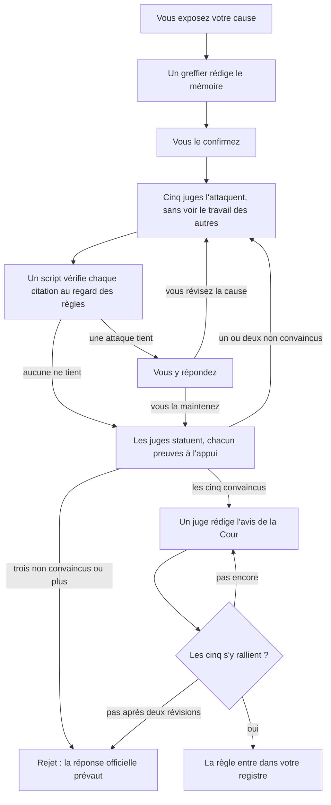

<h1 align="center">
  <picture>
    <source media="(prefers-color-scheme: dark)" srcset="assets/bb-lockup-dark-bg.svg">
    
  </picture>
</h1>

<p align="center">
  Des réponses aux questions de règles de Magic: The Gathering tirées des documents officiels, avec citations, pour Claude.
</p>

<p align="center">
  <a href="https://github.com/smithy-org/bishop-and-barrister/releases/latest"></a>
  <a href="https://github.com/smithy-org/bishop-and-barrister/actions/workflows/tests.yml"></a>
  <a href="LICENSE"></a>
  <a href="https://ko-fi.com/pjderouen"></a>
</p>

<p align="center">
  <a href="README.md">English</a> · <a href="README-de.md">Deutsch</a> · <a href="README-es.md">Español</a> · Français · <a href="README-it.md">Italiano</a> · <a href="README-ja.md">日本語</a>
</p>

<p align="center">
  <em>Ceci est une traduction du <a href="README.md">README anglais</a> ; en cas de divergence, c'est la version anglaise qui fait foi.</em>
</p>

Un skill pour Claude qui répond aux questions de règles de Magic: The Gathering à partir des Comprehensive Rules
officielles et du texte Oracle actuel des cartes, plutôt que de mémoire, et qui cite les règles sur lesquelles il s'appuie.

> **Vous :** J'ai `[[Blood Moon]] (Lune de sang)` en jeu. Est-ce que `[[Urborg, Tomb of Yawgmoth]] (Urborg, tombe de Yaugzebul)`
> de mon adversaire fait toujours de ses terrains des Marais ?
>
> **Claude :** Non. `[[Blood Moon]] (Lune de sang)` en fait une Montagne, et un terrain qui devient d'un type de terrain
> de base perd ses autres capacités (305.7). Les deux effets s'appliquent en couche 4 (613.1d) ; comme l'un supprime
> l'autre, `[[Blood Moon]] (Lune de sang)` s'applique en premier (613.8a), si bien qu'aucun terrain ne devient un Marais.

## Sommaire

- [Fonctionnalités](#fonctionnalités)
- [Prérequis](#prérequis)
- [Fonctionnement](#fonctionnement)
- [Installation](#installation)
- [Utilisation](#utilisation)
- [Projets futurs](#projets-futurs)
- [Soutien](#soutien)
- [Licence](#licence)
- [Contenu de fan](#contenu-de-fan)

## Fonctionnalités

- **Des réponses sourcées.** Chaque réponse nomme ses règles (`704.5g`, et non « la règle des actions basées sur un état »).
- **Toujours à jour.** Le texte Oracle, les décisions officielles et la légalité viennent en direct de
  [Scryfall](https://scryfall.com) ; les documents de règles se mettent à jour sur demande.
- **Prêt pour les tournois.** Le MTR, l'IPG et le JAR, cités par section et par date, en distinguant bien le REL
  Régulier du REL Compétitif.
- **Onze formats.** Commander, Brawl, Oathbreaker, Standard, Pionnier, Modern, Legacy, Vintage, Pauper, Draft
  et Scellé.
- **Honnête quand rien n'est tranché.** Si aucun texte officiel ne règle une question, il le dit et vous renvoie
  vers un arbitre.
- **Contestations.** Contestez une réponse devant cinq juges adverses ; seule une cause unanime entre dans votre
  registre. Voir [CHALLENGE.md](plugin/skills/bishop-and-barrister/CHALLENGE.md).
- **En local.** Votre registre de décisions et vos documents restent sur votre machine.

## Prérequis

- Claude Code, ou claude.ai avec l'exécution de code activée.
- Python 3.10 ou ultérieur, et git.
- [`pypdf`](https://pypi.org/project/pypdf/) pour les documents de tournoi (`pip install pypdf`).

## Fonctionnement

Les sources sont classées par autorité, et le skill les consulte dans cet ordre :

| Niveau | Source |
| ------ | ------ |
| 1 | Les Comprehensive Rules, le texte Oracle et les décisions officielles de Wizards |
| 2 | Les documents de tournoi (MTR, IPG, JAR), et les règles qui s'imposent à un format donné |
| 3 | Les messages informels de l'équipe de Wizards : sur X, Bluesky ou Discord, et les articles qui ne sont pas des documents de règles |
| 4 | Le consensus des arbitres et de la communauté, et les notes propres à Scryfall |
| 5 | Les règles que vous avez introduites par contestation, qui ne priment jamais sur le niveau 1 |

Les forums et les résumés rédigés par une IA ne sont jamais des sources ([`trusted-sources.json`](plugin/skills/bishop-and-barrister/reference/trusted-sources.json)).
Rien de ce que répond Claude n'est enregistré : votre registre de décisions dans `~/.claude/bishop-and-barrister/`
part des décisions officielles, ne s'enrichit que par les contestations, et signale toute règle dont les sources
changent.

**Bishop.** Des questions de règles aux réponses connues, posées avec et sans le skill et notées par rapport aux
règles officielles (part des vérifications réussies, dernière exécution de chaque groupe ; détails dans
[`evals/BASELINE.md`](evals/BASELINE.md)) :

|                                                  | Claude seul | Avec Bishop & Barrister |
| ------------------------------------------------ | ----------- | ----------------------- |
| Toutes les questions (30)                        | 68%         | **100%**                 |
| Cartes plus récentes que l'entraînement de Claude | 39%         | **100%**                |
| Pénalités et corrections en tournoi              | 52%         | **100%**                |
| Réponses citant des règles réelles et pertinentes | 57%         | **100%**                |

**Barrister.** Une règle n'entre dans votre registre qu'à l'issue d'une contestation, et cette procédure est écrite
en [Lean 4](https://lean-lang.org), un langage fonctionnel dont le compilateur vérifie des preuves mathématiques.
23 théorèmes sont vérifiés à chaque build ; si l'un d'eux échoue, rien n'est publié.



Un **greffier** met votre argumentation sous forme de faits et d'étapes numérotés qui citent chacun une source, et
un script **vérificateur** contrôle chaque citation au regard des règles qu'elle invoque. Chacun des cinq juges a
un angle d'analyse différent, pour qu'ils ne commettent pas tous la même erreur ; ils travaillent en parallèle et ne
peuvent pas voir le travail des autres avant que les cinq aient rendu le leur :

1. **Le livre de règles.** Lit en entier chaque règle citée, à la recherche des conditions que la cause passe sous
   silence, des exceptions et des règles ultérieures. Dans un cas d'évaluation, il a établi que « le premier joueur
   à perdre choisit » ne tient plus en partie par équipes, où un joueur éliminé tôt peut encore gagner (104.2c).
2. **Cartes et décisions.** Lit le texte des cartes mot à mot, puisque le texte d'une carte prime sur les règles,
   et cherche des décisions officielles sur des cartes similaires qui iraient dans l'autre sens.
3. **Simulation de l'état de jeu.** Rejoue la situation étape par étape : la pile, la priorité, les capacités
   déclenchées, les actions basées sur un état, les couches.
4. **Contre-exemples et logique.** Trouve d'autres situations où la règle se trompe, et les failles de
   l'argumentation.
5. **Documents de tournoi et formats.** Vérifie si un format ou un niveau d'événement change la réponse, ou si une
   règle de tournoi la tranche déjà.

Les théorèmes garantissent :

- **Aucune règle indue :** les cinq juges convaincus preuves à l'appui, chaque citation vérifiée, aucun conflit
  avec les règles officielles, et un avis auquel les cinq se rallient.
- **Pas de coup d'œil :** un juge ne peut pas voir le travail des autres pendant le tour en cours.
- **Déterministe :** le même registre donne le même résultat sur tous les appareils.
- **Définitif :** une règle, une fois introduite, ne peut pas être annulée par la procédure.
- **Rien de bloqué ni de perdu :** chaque contestation ouverte indique qui doit agir ensuite, et les modifications
  contradictoires sont détectées.

Les preuves portent sur la procédure, pas sur les règles de Magic ; les réponses courantes reposent sur les
documents cités.

## Installation

### Claude Code

```
/plugin install bishop-and-barrister --marketplace https://github.com/smithy-org/bishop-and-barrister.git
```

Démarrez ensuite une nouvelle session. Avec une version de Claude Code antérieure à 2.1.275, lancez d'abord
`/plugin marketplace add https://github.com/smithy-org/bishop-and-barrister.git`, puis
`/plugin install bishop-and-barrister@smithy-org`. Utilisez l'adresse HTTPS complète : la forme courte
`owner/repo` clone via SSH et échoue sans clé SSH GitHub.

### claude.ai

1. Téléchargez `bishop-and-barrister.zip` depuis la
   [dernière version](https://github.com/smithy-org/bishop-and-barrister/releases/latest). (Le bouton « Download
   ZIP » de GitHub ne convient pas : claude.ai a besoin d'un dossier nommé `bishop-and-barrister`.)
2. Activez Settings, Capabilities, « Code execution and file creation ».
3. Importez le zip sous Skills, sur la même page.

Pas encore testé sur claude.ai ; le skill doit pouvoir joindre scryfall.com, media.wizards.com et github.com.

### Les documents de règles

Claude télécharge les Comprehensive Rules et les documents de tournoi la première fois qu'il en a besoin, dans
`~/.claude/bishop-and-barrister/documents/`.

## Utilisation

Posez votre question comme vous la poseriez à un arbitre ; le skill se charge tout seul :

- « Est-ce que le contact mortel combiné au piétinement me permet d'assigner 1 blessure au bloqueur ? »
- « Avec `[[Humility]] (Humilité)` et `[[Opalescence]] (Opalescence)` tous deux en jeu, quelles sont la force et
  l'endurance des créatures ? »
- « En REL Compétitif, quelle est la pénalité pour avoir pioché une carte en trop ? »

Si une réponse ne cite rien, appelez le skill par son nom : `/bishop-and-barrister:bishop-and-barrister <question>`.

- **Nouvelle version des règles ?** Demandez à Claude de « vérifier les mises à jour des documents de règles de
  Bishop & Barrister ».
- **Pas d'accord avec une réponse ?** Dites « Je veux contester cette décision ». Claude annonce d'abord le coût :
  une contestation consomme jusqu'à quelques millions de tokens. Détails dans
  [CHALLENGE.md](plugin/skills/bishop-and-barrister/CHALLENGE.md).

## Projets futurs

Selon l'intérêt suscité : un **envoi vers le cloud**, pour synchroniser votre registre de décisions entre vos
appareils, et une **plateforme sociale de règles**, pour partager et trancher des décisions avec d'autres joueurs.
Intéressé ? Faites-le savoir dans une [issue](https://github.com/smithy-org/bishop-and-barrister/issues).

## Soutien

Gratuit, pour toujours. S'il met fin à un débat à votre table, vous pouvez laisser un pourboire facultatif du montant
de votre choix sur [Ko-fi](https://ko-fi.com/pjderouen) ; cela ne débloque rien. Signalez les bugs et les réponses
erronées dans les [issues](https://github.com/smithy-org/bishop-and-barrister/issues).

## Licence

[Apache License 2.0](LICENSE). Toute redistribution doit conserver le fichier [NOTICE](NOTICE), qui contient la
déclaration relative au Fan Content ci-dessous. La licence couvre le code et les textes propres à ce projet, et non
les contenus de Wizards of the Coast ni les données de Scryfall.

## Contenu de fan

Bishop & Barrister is unofficial Fan Content permitted under the Fan Content Policy. Not approved/endorsed by
Wizards. Portions of the materials used are property of Wizards of the Coast. ©Wizards of the Coast LLC.

*Traduction non officielle :* Bishop & Barrister est un contenu de fan non officiel autorisé par la Fan Content
Policy. Non approuvé ni soutenu par Wizards. Certaines parties des contenus utilisés sont la propriété de Wizards
of the Coast. ©Wizards of the Coast LLC.

Les données de cartes et les décisions officielles proviennent de [Scryfall](https://scryfall.com), qui n'est pas
affilié à ce projet.
