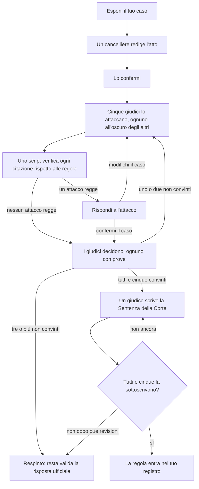

<h1 align="center">
  <picture>
    <source media="(prefers-color-scheme: dark)" srcset="assets/bb-lockup-dark-bg.svg">
    
  </picture>
</h1>

<p align="center">
  Risposte sulle regole di Magic: The Gathering tratte dai documenti ufficiali, con citazioni, per Claude.
</p>

<p align="center">
  <a href="https://github.com/smithy-org/bishop-and-barrister/releases/latest"></a>
  <a href="https://github.com/smithy-org/bishop-and-barrister/actions/workflows/tests.yml"></a>
  <a href="LICENSE"></a>
  <a href="https://ko-fi.com/pjderouen"></a>
</p>

<p align="center">
  <a href="README.md">English</a> · <a href="README-de.md">Deutsch</a> · <a href="README-es.md">Español</a> · <a href="README-fr.md">Français</a> · Italiano · <a href="README-ja.md">日本語</a>
</p>

<p align="center">
  <em>Questa è una traduzione del <a href="README.md">English README</a>; in caso di differenze, fa fede la versione inglese.</em>
</p>

Claude risponde alle domande sulle regole di Magic a memoria, e la memoria non conosce le nuove espansioni, le
errata e le interazioni in cui l'intuito sbaglia. Bishop & Barrister fa sì che Claude cerchi la risposta nelle
Comprehensive Rules, nel testo Oracle e nei documenti di torneo aggiornati, e che citi la regola.

> **Tu:** Ho `[[Blood Moon]] (Luna Insanguinata)` in gioco. La `[[Urborg, Tomb of Yawgmoth]] (Urborg, Tomba di Yawgmoth)`
> del mio avversario rende ancora Paludi le sue terre?
>
> **Claude:** No. `[[Blood Moon]] (Luna Insanguinata)` la trasforma in una Montagna, e una terra che diventa di un
> tipo di terra base perde le sue altre abilità (305.7). Entrambi gli effetti si applicano nel livello 4 (613.1d);
> poiché uno elimina l'altro, `[[Blood Moon]] (Luna Insanguinata)` si applica per primo (613.8a), quindi nessuna
> terra diventa una Palude.

## Indice

- [Funzionalità](#funzionalità)
- [Requisiti](#requisiti)
- [Come funziona](#come-funziona)
- [Installazione](#installazione)
- [Utilizzo](#utilizzo)
- [Piani futuri](#piani-futuri)
- [Supporto](#supporto)
- [Licenza](#licenza)
- [Fan Content](#fan-content)

## Funzionalità

- **Risposte con citazioni.** Ogni risposta indica le sue regole (`704.5g`, non "la regola delle azioni generate
  dallo stato").
- **Sempre aggiornato.** Testo Oracle, ruling e legalità arrivano in tempo reale da [Scryfall](https://scryfall.com);
  i documenti delle regole si aggiornano su richiesta.
- **Pronto per i tornei.** MTR, IPG e JAR, citati per sezione e data, tenendo separati il REL Regular e il
  REL Competitive.
- **Undici formati.** Commander, Brawl, Oathbreaker, Standard, Pioneer, Modern, Legacy, Vintage, Pauper, Draft
  e Sealed.
- **Onesto quando la questione è aperta.** Se nessuna fonte ufficiale risolve una domanda, lo dice e ti indirizza
  a un giudice.
- **Ricorsi.** Contesta una risposta davanti a cinque giudici avversariali; solo un caso approvato all'unanimità
  entra nel tuo registro. Vedi [CHALLENGE.md](plugin/skills/bishop-and-barrister/CHALLENGE.md).
- **In locale.** Il tuo registro dei ruling e i documenti restano sul tuo computer.

## Requisiti

- Claude Code, oppure claude.ai con l'esecuzione del codice attivata.
- Python 3.10 o successivo, e git.
- [`pypdf`](https://pypi.org/project/pypdf/) per i documenti di torneo (`pip install pypdf`).

## Come funziona

Le fonti sono ordinate per autorevolezza, e la skill le consulta in quest'ordine:

| Livello | Fonte |
| ----- | ------ |
| 1 | Le Comprehensive Rules, il testo Oracle e i ruling ufficiali di Wizards |
| 2 | I documenti di torneo (MTR, IPG, JAR) e le regole vincolanti per un singolo formato |
| 3 | Interventi informali dello staff di Wizards: su X, Bluesky o Discord, e articoli che non sono documenti di regole |
| 4 | Il consenso dei giudici e della community, e le note di Scryfall |
| 5 | Le regole che hai introdotto tramite ricorso, che non prevalgono mai sul livello 1 |

Forum e riassunti scritti da un'IA non sono mai fonti ([`trusted-sources.json`](plugin/skills/bishop-and-barrister/reference/trusted-sources.json)).
Nulla di ciò che Claude risponde viene registrato: il tuo registro dei ruling in `~/.claude/bishop-and-barrister/`
parte dai ruling ufficiali, cresce solo tramite i ricorsi e segnala ogni regola le cui fonti cambiano.

**Bishop.** Domande sulle regole con risposte note, poste con e senza la skill e valutate rispetto alle regole
ufficiali (percentuale di verifiche superate, ultima esecuzione di ciascun gruppo; dettagli in
[`evals/BASELINE.md`](evals/BASELINE.md)):

|                                     | Claude da solo | Con Bishop & Barrister |
| ----------------------------------- | ----------------- | ----------------------- |
| Tutte le domande (29)               | 69%               | **98%**                 |
| Carte più recenti dell'addestramento di Claude | 39%    | **100%**                |
| Penalità e correzioni di torneo     | 52%               | **100%**                |
| Risposte che citano regole reali e pertinenti | 68%     | **100%**                |

**Barrister.** Una regola entra nel tuo registro solo tramite un ricorso, e quel procedimento è scritto in
[Lean 4](https://lean-lang.org), un linguaggio funzionale il cui compilatore verifica dimostrazioni matematiche.
23 teoremi vengono verificati a ogni build; se uno non regge, non viene rilasciato nulla.



Un **cancelliere** traduce la tua argomentazione in fatti e passaggi numerati, ognuno dei quali cita una sola fonte,
e uno script **verificatore** controlla ogni citazione rispetto alle regole a cui fa riferimento. Ciascuno dei
cinque giudici ha una prospettiva diversa, così non commettono tutti lo stesso errore; lavorano in parallelo e non
possono vedere il lavoro degli altri finché tutti e cinque non hanno depositato il proprio:

1. **Il regolamento.** Legge per intero ogni regola citata cercando condizioni che il caso trascura, eccezioni e
   regole successive. In un caso di valutazione ha scoperto che "sceglie il primo giocatore che perde" non funziona
   nelle partite a squadre, dove chi perde presto può comunque vincere (104.2c).
2. **Carte e ruling.** Legge il testo delle carte parola per parola, perché il testo della carta prevale sulle
   regole, e cerca ruling ufficiali su carte simili che vadano nella direzione opposta.
3. **Simulazione dello stato di gioco.** Svolge la situazione passo dopo passo: la pila, la priorità, le abilità
   innescate, le azioni generate dallo stato, i livelli.
4. **Controesempi e logica.** Trova altre situazioni in cui la regola sbaglia, e lacune nell'argomentazione.
5. **Documenti di torneo e formati.** Verifica se un formato o un livello di evento cambia la risposta, o se una
   regola di torneo risolve già la questione.

I teoremi garantiscono:

- **Nessuna regola immeritata:** tutti e cinque i giudici convinti con prove, ogni citazione verificata, nessun
  conflitto con le regole ufficiali, e una sentenza sottoscritta da tutti e cinque.
- **Nessuna sbirciata:** un giudice non può vedere il lavoro degli altri nel turno in corso.
- **Deterministico:** lo stesso registro dà lo stesso risultato su ogni dispositivo.
- **Definitivo:** una regola, una volta introdotta, non può essere annullata dal procedimento.
- **Niente di bloccato o perso:** ogni ricorso aperto indica chi deve agire per primo, e le modifiche in conflitto
  vengono intercettate.

Le dimostrazioni riguardano il procedimento, non le regole di Magic; le risposte di tutti i giorni si basano sui
documenti citati.

## Installazione

### Claude Code

```
/plugin install bishop-and-barrister --marketplace https://github.com/smithy-org/bishop-and-barrister.git
```

Poi avvia una nuova sessione. Sulle versioni di Claude Code precedenti alla 2.1.275, esegui prima
`/plugin marketplace add https://github.com/smithy-org/bishop-and-barrister.git`, poi
`/plugin install bishop-and-barrister@smithy-org`. Usa l'indirizzo HTTPS completo: la forma breve `owner/repo`
clona via SSH e fallisce senza una chiave SSH di GitHub.

### claude.ai

1. Scarica `bishop-and-barrister.zip` dalla
   [versione più recente](https://github.com/smithy-org/bishop-and-barrister/releases/latest). (Il "Download
   ZIP" di GitHub non funziona: claude.ai ha bisogno che la cartella si chiami `bishop-and-barrister`.)
2. Attiva Settings, Capabilities, "Code execution and file creation".
3. Carica lo zip nella sezione Skills della stessa pagina.

Non ancora testato su claude.ai; la skill deve poter raggiungere scryfall.com, media.wizards.com e github.com.

### I documenti delle regole

Claude scarica le Comprehensive Rules e i documenti di torneo la prima volta che gli servono, in
`~/.claude/bishop-and-barrister/documents/`.

## Utilizzo

Chiedi come chiederesti a un giudice; la skill si carica da sola:

- "Tocco letale più travolgere mi permette di assegnare 1 danno al bloccante?"
- "Con `[[Humility]] (Umiltà)` e `[[Opalescence]] (Opalescenza)` entrambe in gioco, quali sono la forza e la
  costituzione delle creature?"
- "Al REL Competitive, qual è la penalità per aver pescato una carta in più?"

Se una risposta non ha citazioni, richiama la skill per nome: `/bishop-and-barrister:bishop-and-barrister <question>`.

- **È uscita una nuova versione delle regole?** Chiedi a Claude di "controllare se ci sono aggiornamenti ai
  documenti delle regole di Bishop & Barrister".
- **Non sei d'accordo con una risposta?** Di' "Voglio fare ricorso contro quel ruling". Claude indica prima il
  costo: un ricorso consuma fino a qualche milione di token. Dettagli in
  [CHALLENGE.md](plugin/skills/bishop-and-barrister/CHALLENGE.md).

## Piani futuri

A seconda dell'interesse: il **caricamento nel cloud**, per mantenere il tuo registro dei ruling sincronizzato tra
i dispositivi, e una **piattaforma social per le regole**, per condividere e risolvere ruling con altri giocatori.
Ti interessa? Faccelo sapere in una [issue](https://github.com/smithy-org/bishop-and-barrister/issues).

## Supporto

Gratuito, sempre. Se risolve una discussione al tuo tavolo, puoi lasciare una mancia facoltativa di qualsiasi
importo su [Ko-fi](https://ko-fi.com/pjderouen); non sblocca nulla. Segnala bug e risposte sbagliate come
[issue](https://github.com/smithy-org/bishop-and-barrister/issues).

## Licenza

[Apache License 2.0](LICENSE). Le ridistribuzioni devono mantenere il file [NOTICE](NOTICE), che riporta la
dichiarazione sul Fan Content qui sotto. La licenza copre il codice e i testi di questo progetto, non i materiali
di Wizards of the Coast né i dati di Scryfall.

## Fan Content

Bishop & Barrister is unofficial Fan Content permitted under the Fan Content Policy. Not approved/endorsed by
Wizards. Portions of the materials used are property of Wizards of the Coast. ©Wizards of the Coast LLC.

*Traduzione non ufficiale:* Bishop & Barrister è un Fan Content non ufficiale consentito dalla Fan Content Policy.
Non approvato/sostenuto da Wizards. Parti dei materiali utilizzati sono di proprietà di Wizards of the Coast.
©Wizards of the Coast LLC.

I dati delle carte e i ruling provengono da [Scryfall](https://scryfall.com), che non è affiliato a questo progetto.
