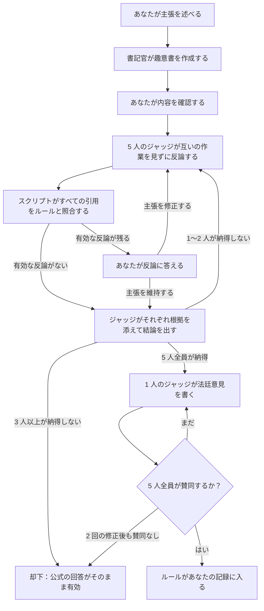

<h1 align="center">
  <picture>
    <source media="(prefers-color-scheme: dark)" srcset="assets/bb-lockup-ja-dark-bg.svg">
    
  </picture>
</h1>

<p align="center">
  Claude のための、公式文書に基づき出典つきで答えるマジック：ザ・ギャザリングのルール回答スキル。
</p>

<p align="center">
  <a href="https://github.com/smithy-org/bishop-and-barrister/releases/latest"></a>
  <a href="https://github.com/smithy-org/bishop-and-barrister/actions/workflows/tests.yml"></a>
  <a href="LICENSE"></a>
  <a href="https://ko-fi.com/pjderouen"></a>
</p>

<p align="center">
  <a href="README.md">English</a> · <a href="README-de.md">Deutsch</a> · <a href="README-es.md">Español</a> · <a href="README-fr.md">Français</a> · <a href="README-it.md">Italiano</a> · 日本語
</p>

<p align="center">
  <i>この文書は<a href="README.md">英語版 README</a> の翻訳です。内容に相違がある場合は、英語版が優先されます。</i>
</p>

記憶に頼らず、公式の総合ルール（Comprehensive Rules）と最新のカードの Oracle テキストに基づいてマジック：ザ・ギャザリングの
ルールに関する質問に答え、根拠となるルールを示す Claude のスキルです。

> **あなた：** 私は `[[Blood Moon]]（血染めの月）` を出しています。対戦相手の `[[Urborg, Tomb of Yawgmoth]]（ヨーグモスの墳墓、アーボーグ）` は、
> まだ相手の土地を沼にしますか？
>
> **Claude：** いいえ。`[[Blood Moon]]（血染めの月）` によってそれは山になり、基本土地タイプが設定された土地はそれ以外の
> 能力を失います（305.7）。どちらの効果も種類別第4種で適用されます（613.1d）。一方が他方を消し去るため
> `[[Blood Moon]]（血染めの月）` が先に適用され（613.8a）、どの土地も沼にはなりません。

## 目次

- [特長](#特長)
- [動作要件](#動作要件)
- [仕組み](#仕組み)
- [インストール](#インストール)
- [使い方](#使い方)
- [今後の予定](#今後の予定)
- [サポート](#サポート)
- [ライセンス](#ライセンス)
- [ファンコンテンツ](#ファンコンテンツ)

## 特長

- **出典つきの回答。** すべての回答で根拠のルールを番号で示します（「状態起因処理のルール」ではなく `704.5g`）。
- **常に最新。** Oracle テキスト、裁定、フォーマットの使用可否は [Scryfall](https://scryfall.com) からその場で取得し、
  ルール文書は依頼に応じて更新します。
- **トーナメントにも対応。** MTR、IPG、JAR をセクションと日付つきで引用し、一般ルール適用度（Regular REL）と
  競技ルール適用度（Competitive REL）を区別して扱います。
- **11 のフォーマット。** 統率者戦、ブロール、Oathbreaker、スタンダード、パイオニア、モダン、レガシー、ヴィンテージ、
  パウパー、ドラフト、シールド。
- **決まっていないことは正直に。** 公式に決着していない問題であれば、そう伝えたうえでジャッジに確認するよう案内します。
- **異議申し立て。** 回答に納得できなければ、反論役の 5 人のジャッジの前で争えます。全員一致で認められたものだけが
  あなたの記録に入ります。詳しくは [CHALLENGE.md](plugin/skills/bishop-and-barrister/CHALLENGE.md) をご覧ください。
- **ローカル動作。** 裁定の記録や文書はあなたのマシンの中だけに保存されます。

## 動作要件

- Claude Code、またはコード実行を有効にした claude.ai。
- Python 3.10 以降と git。
- トーナメント文書を読むための [`pypdf`](https://pypi.org/project/pypdf/)（`pip install pypdf`）。

## 仕組み

情報源には権威の順位があり、スキルはその順に参照します。

| レベル | 情報源 |
| ----- | ------ |
| 1 | 総合ルール（Comprehensive Rules）、Oracle テキスト、Wizards 社の公式裁定 |
| 2 | トーナメント文書（MTR、IPG、JAR）と、特定のフォーマットにのみ適用される拘束力のあるルール |
| 3 | Wizards 社スタッフによる非公式な発言：X、Bluesky、Discord への投稿や、ルール文書ではない記事 |
| 4 | ジャッジやコミュニティの共通見解と、Scryfall 独自の注記 |
| 5 | 異議申し立てを通じてあなたが導入したルール。レベル 1 に優先することはありません |

掲示板や AI が書いた要約は、決して情報源にはなりません（[`trusted-sources.json`](plugin/skills/bishop-and-barrister/reference/trusted-sources.json)）。
Claude の回答そのものは何も記録されません。`~/.claude/bishop-and-barrister/` にある裁定の記録は公式裁定から始まり、
異議申し立てを通じてのみ増えていきます。また、情報源が変わったルールには印が付きます。

**Bishop（ビショップ）。** 答えが分かっているルールの質問を、スキルありとスキルなしでそれぞれ尋ね、公式ルールに照らして
採点しました（合格したチェックの割合、各グループの最新の実行結果。詳細は
[`evals/BASELINE.md`](evals/BASELINE.md)）。

|                                     | Claude 単体 | Bishop & Barrister あり |
| ----------------------------------- | ----------------- | ----------------------- |
| 全質問（30 問）                     | 68%               | **100%**                 |
| Claude の学習時期より新しいカード    | 39%               | **100%**                |
| トーナメントの罰則と修正処置         | 52%               | **100%**                |
| 実在し、かつ当てはまるルールを引用した回答 | 57%         | **100%**                |

**Barrister（バリスター）。** ルールがあなたの記録に入るのは異議申し立てを経た場合だけで、その手続きは
[Lean 4](https://lean-lang.org) で書かれています。Lean 4 は、コンパイラが数学的証明を検査する関数型言語です。
23 個の定理がビルドのたびに検査され、ひとつでも成り立たなくなればリリースされません。



**書記官**はあなたの主張を、それぞれ 1 つの情報源を引用する番号つきの事実と手順に整理し、**検証**スクリプトが
すべての引用を、引用元のルールと照合します。5 人のジャッジはそれぞれ異なる観点を持つため、全員が同じ誤りを犯すことは
ありません。ジャッジは並行して作業し、5 人全員が提出し終えるまで互いの作業を見ることはできません。

1. **ルールブック。** 引用されたルールをすべて全文で読み、主張が見落としている条件、例外、後続のルールを探します。
   ある評価ケースでは、「最初に敗北したプレイヤーが選ぶ」という考え方が、先に敗北したプレイヤーがまだ勝利しうる
   チーム戦では破綻することを見つけました（104.2c）。
2. **カードと裁定。** カードのテキストはルールに優先するため、カードの文面を一語ずつ読み、似たカードについて逆の結論を
   示す公式裁定がないかを探します。
3. **ゲーム状況のシミュレーション。** スタック、優先権、誘発、状態起因処理、種類別といった流れに沿って、状況を
   一手ずつ再現します。
4. **反例と論理。** そのルールでは誤った結果になる別の状況や、論証の穴を探します。
5. **トーナメント文書とフォーマット。** フォーマットやイベントのルール適用度によって答えが変わらないか、あるいは
   トーナメントのルールですでに決着していないかを確認します。

定理によって保証されること：

- **根拠なきルールはない：** 5 人のジャッジ全員が根拠をもって納得し、すべての引用が検証済みで、公式ルールと
  矛盾せず、5 人全員が賛同する意見が 1 つあること。
- **のぞき見できない：** ジャッジは進行中のラウンドで他のジャッジの作業を見られません。
- **決定的：** 同じ記録からは、どのデバイスでも同じ結果が得られます。
- **確定的：** 一度導入されたルールは、この手続きによって取り消されることはありません。
- **停滞も消失もない：** 進行中の異議申し立てには必ず次に行動する者が示され、競合する編集は検出されます。

証明が対象とするのは手続きであり、マジックのルールそのものではありません。日常の回答は、引用された文書に基づいています。

## インストール

### Claude Code

```
/plugin install bishop-and-barrister --marketplace https://github.com/smithy-org/bishop-and-barrister.git
```

その後、新しいセッションを開始してください。Claude Code 2.1.275 より前のバージョンでは、先に
`/plugin marketplace add https://github.com/smithy-org/bishop-and-barrister.git` を実行し、次に
`/plugin install bishop-and-barrister@smithy-org` を実行してください。HTTPS の完全なアドレスを使ってください。
短い `owner/repo` 形式は SSH でクローンするため、GitHub の SSH キーがないと失敗します。

### claude.ai

1. [最新リリース](https://github.com/smithy-org/bishop-and-barrister/releases/latest)から
   `bishop-and-barrister.zip` をダウンロードします。（GitHub の「Download ZIP」は使えません。claude.ai では
   フォルダー名が `bishop-and-barrister` である必要があります。）
2. Settings の Capabilities で「Code execution and file creation」を有効にします。
3. 同じページの Skills から zip をアップロードします。

claude.ai ではまだテストしていません。スキルが scryfall.com、media.wizards.com、github.com にアクセスできる必要があります。

### ルール文書

Claude は総合ルール（Comprehensive Rules）とトーナメント文書を、最初に必要になったときに
`~/.claude/bishop-and-barrister/documents/` へダウンロードします。

## 使い方

ジャッジに尋ねるのと同じように質問してください。スキルは自動で読み込まれます。

- 「接死とトランプルを持っていたら、ブロッカーに 1 点だけダメージを割り振れますか？」
- 「`[[Humility]]（謙虚）` と `[[Opalescence]]（オパール色の輝き）` が両方戦場にあるとき、クリーチャーのパワーとタフネスはいくつですか？」
- 「競技ルール適用度で、カードを余分に引いてしまったときの罰則は何ですか？」

回答に出典がない場合は、名前を指定して呼び出してください：`/bishop-and-barrister:bishop-and-barrister <question>`。

- **新しいルールが公開されたら？** Claude に「Bishop & Barrister のルール文書に更新がないか確認して」と頼んでください。
- **回答に納得できない？** 「その裁定に異議を申し立てたい」と伝えてください。Claude はまずコストを提示します。異議申し立てには
  最大で数百万トークンを使います。詳しくは [CHALLENGE.md](plugin/skills/bishop-and-barrister/CHALLENGE.md) をご覧ください。

## 今後の予定

関心の度合いに応じて、裁定の記録を複数のデバイス間で同期する**クラウドアップロード**と、他のプレイヤーと裁定を共有し
決着をつける**ソーシャル・ルール・プラットフォーム**を検討しています。興味があれば
[issue](https://github.com/smithy-org/bishop-and-barrister/issues) でお知らせください。

## サポート

いつまでも無料です。あなたの卓での言い争いに決着がついたなら、[Ko-fi](https://ko-fi.com/pjderouen) で好きな金額の
チップを任意で送ることができます。チップで何かが解放されることはありません。バグや誤った回答は
[issues](https://github.com/smithy-org/bishop-and-barrister/issues) で報告してください。

## ライセンス

[Apache License 2.0](LICENSE)。再配布の際は [NOTICE](NOTICE) を残す必要があります。NOTICE には下記のファンコンテンツに
関する声明が含まれています。このライセンスが対象とするのは本プロジェクト独自のコードとテキストであり、
Wizards of the Coast 社の素材や Scryfall のデータは対象外です。

## ファンコンテンツ

Bishop & Barrister is unofficial Fan Content permitted under the Fan Content Policy. Not approved/endorsed by
Wizards. Portions of the materials used are property of Wizards of the Coast. ©Wizards of the Coast LLC.

（非公式訳）Bishop & Barrister は、ファンコンテンツ・ポリシーのもとで認められた非公式のファンコンテンツです。
Wizards 社の承認・推奨を受けたものではありません。使用している素材の一部は Wizards of the Coast 社の財産です。
©Wizards of the Coast LLC.

カードデータと裁定は [Scryfall](https://scryfall.com) から取得しています。Scryfall は本プロジェクトとは関係ありません。
