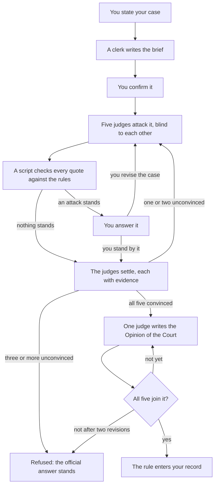

<h1 align="center">
  <picture>
    <source media="(prefers-color-scheme: dark)" srcset="assets/bb-lockup-dark-bg.svg">
    
  </picture>
</h1>

<p align="center">
  Magic: The Gathering rules answers from the official documents, with citations, for Claude.
</p>

<p align="center">
  <a href="https://github.com/smithy-org/bishop-and-barrister/releases/latest"></a>
  <a href="https://github.com/smithy-org/bishop-and-barrister/actions/workflows/tests.yml"></a>
  <a href="LICENSE"></a>
  <a href="https://ko-fi.com/pjderouen"></a>
</p>

Claude answers Magic rules questions from memory, and memory misses new sets, errata and the interactions where
intuition fails. Bishop & Barrister makes Claude look the answer up in the current Comprehensive Rules, Oracle
text and tournament documents, and cite the rule.

> **You:** I have Blood Moon out. Does my opponent's Urborg, Tomb of Yawgmoth still make their lands Swamps?
>
> **Claude:** No. Blood Moon makes Urborg a Mountain, and a land set to a basic land type loses its other
> abilities (305.7), so no land becomes a Swamp. Both effects apply in layer 4 (613.1d), and Urborg's depends
> on Blood Moon's (613.8a), so their order doesn't matter.

## Contents

- [Features](#features)
- [Requirements](#requirements)
- [Functionally Designed](#functionally-designed)
- [Installation](#installation)
- [Usage](#usage)
- [How it works](#how-it-works)
- [Future plans](#future-plans)
- [Support](#support)
- [Licence](#licence)
- [Fan Content](#fan-content)

## Features

- **Cited answers.** Every answer names its rules (`704.5g`, not "the state-based action rule").
- **Always current.** Oracle text, rulings and legality come live from [Scryfall](https://scryfall.com); the
  rules documents update on request.
- **Tournament-ready.** The MTR, IPG and JAR, cited by section and date, with Regular and Competitive REL kept
  apart.
- **Eleven formats.** Commander, Brawl, Oathbreaker, Standard, Pioneer, Modern, Legacy, Vintage, Pauper, Draft
  and Sealed.
- **Honest when unsettled.** If nothing official decides a question, it says so and points you to a judge.
- **Challenges.** Dispute an answer before five adversarial judges; only a unanimous case enters your record.
  See [CHALLENGE.md](CHALLENGE.md).
- **Local.** Your rulings record and documents stay on your machine.

## Requirements

- Claude Code, or claude.ai with code execution turned on.
- Python 3.10 or later, and git.
- [`pypdf`](https://pypi.org/project/pypdf/) for the tournament documents (`pip install pypdf`).

## Functionally Designed

**Bishop.** Rules questions with known answers, asked with and without the skill and graded against the
official rules (share of checks passed, latest run of each group; details in
[`evals/BASELINE.md`](evals/BASELINE.md)):

|                                     | Claude on its own | With Bishop & Barrister |
| ----------------------------------- | ----------------- | ----------------------- |
| All questions (29)                  | 69%               | **98%**                 |
| Cards newer than Claude's training  | 39%               | **100%**                |
| Tournament penalties and fixes      | 52%               | **100%**                |
| Answers citing real rules that fit  | 68%               | **100%**                |

**Barrister.** A rule enters your record only through a challenge, and that process is written in
[Lean 4](https://lean-lang.org), a functional language whose compiler checks mathematical proofs. 23 theorems
are checked on every build; if one breaks, nothing ships.



Each judge attacks the case from its own angle:

1. **The Comprehensive Rules.** Reads every cited rule in full, with its subrules, for skipped conditions,
   exceptions and later rules that modify it.
2. **Cards and rulings.** Reads each card's Oracle text word by word, since card text overrides the rules, and
   looks for official rulings on these cards or on cards worded the same way that point the other way.
3. **Game state.** Plays the situation out step by step (the stack, priority, triggers, state-based actions,
   layers) to find where the case's sequence differs from the real one.
4. **Counterexamples and logic.** Finds another situation where the proposed rule gives the wrong answer, and
   checks the argument for hidden assumptions, gaps and quotes stretched past what they say.
5. **Tournaments and formats.** Checks the tournament rules and format rules: whether the question is about
   gameplay at all, and whether a format or enforcement level changes or already settles it.

The theorems guarantee:

- **No unearned rule:** all five judges convinced with evidence, every quote verified, no conflict with the
  official rules, and one opinion all five join.
- **No peeking:** a judge can't see the others' work from the round in progress.
- **Deterministic:** the same record gives the same result on every device.
- **Final:** a rule, once introduced, can't be undone by the process.
- **Nothing stuck or lost:** every open challenge names who acts next, and conflicting edits are caught.

The proofs cover the process, not Magic's rules; everyday answers rest on the cited documents.

## Installation

### Claude Code

```
/plugin install bishop-and-barrister --marketplace https://github.com/smithy-org/bishop-and-barrister.git
```

Then start a new session. On Claude Code before 2.1.275, run
`/plugin marketplace add https://github.com/smithy-org/bishop-and-barrister.git` first, then
`/plugin install bishop-and-barrister@smithy-org`. Use the full HTTPS address: the short `owner/repo` form
clones over SSH and fails without a GitHub SSH key.

### claude.ai

1. Download `bishop-and-barrister.zip` from the
   [latest release](https://github.com/smithy-org/bishop-and-barrister/releases/latest). (GitHub's "Download
   ZIP" won't work: claude.ai needs the folder named `bishop-and-barrister`.)
2. Turn on Settings, Capabilities, "Code execution and file creation".
3. Upload the zip under Skills on the same page.

Not yet tested on claude.ai; the skill needs to reach scryfall.com, media.wizards.com and github.com.

### The rules documents

Claude downloads the Comprehensive Rules and the tournament documents the first time it needs them, into
`~/.claude/bishop-and-barrister/documents/`. They aren't bundled: they belong to Wizards of the Coast and
change several times a year.

## Usage

Ask the way you'd ask a judge; the skill loads by itself:

- "Does deathtouch plus trample let me assign 1 damage to the blocker?"
- "Humility and Opalescence are both on the battlefield. What are the creatures' power and toughness?"
- "At Competitive REL, what's the penalty for drawing an extra card?"

If an answer has no citations, call it by name: `/bishop-and-barrister:bishop-and-barrister <question>`.

- **New rules release?** Ask Claude to "check the Bishop & Barrister rules documents for updates".
- **Disagree with an answer?** Say "I want to challenge that ruling". Claude states the cost first: a challenge
  uses up to a few million tokens. Details in [CHALLENGE.md](CHALLENGE.md).

## How it works

Sources are ranked by authority, and the skill reads them in order:

| Level | Source |
| ----- | ------ |
| 1 | The Comprehensive Rules, Oracle text and Wizards' official rulings |
| 2 | The tournament documents (MTR, IPG, JAR), and rules binding for one format |
| 4 | Judges' and community consensus, and Scryfall's own notes |
| 5 | Rules you introduced by challenge, which never override level 1 |

Forums and AI-written summaries are never sources ([`reference/trusted-sources.json`](reference/trusted-sources.json)).
Nothing Claude answers is recorded: your rulings record in `~/.claude/bishop-and-barrister/` starts with the
official rulings and grows only through challenges, and flags any rule whose sources change.

## Future plans

Depending on interest: **cloud upload**, to keep your rulings record in step across devices, and a **social
rules platform**, to share and settle rulings with other players. Interested? Say so in an
[issue](https://github.com/smithy-org/bishop-and-barrister/issues).

## Support

Free, always. If it settles an argument at your table, you can leave an optional tip of any amount on
[Ko-fi](https://ko-fi.com/pjderouen); it unlocks nothing. Report bugs and wrong answers as
[issues](https://github.com/smithy-org/bishop-and-barrister/issues).

## Licence

[Apache License 2.0](LICENSE). Redistributions must keep the [NOTICE](NOTICE), which carries the Fan Content
statement below. The licence covers this project's own code and text, not Wizards of the Coast's materials or
Scryfall's data.

## Fan Content

Bishop & Barrister is unofficial Fan Content permitted under the Fan Content Policy. Not approved/endorsed by
Wizards. Portions of the materials used are property of Wizards of the Coast. ©Wizards of the Coast LLC.

Card data and rulings come from [Scryfall](https://scryfall.com), which is not affiliated with this project.
